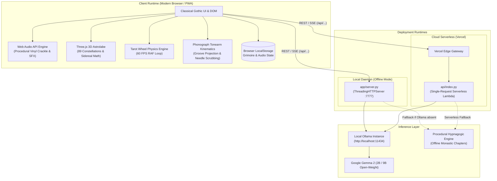
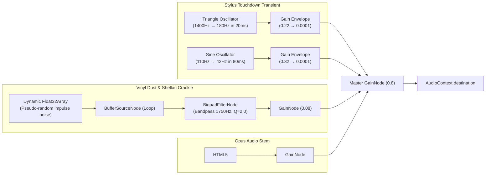
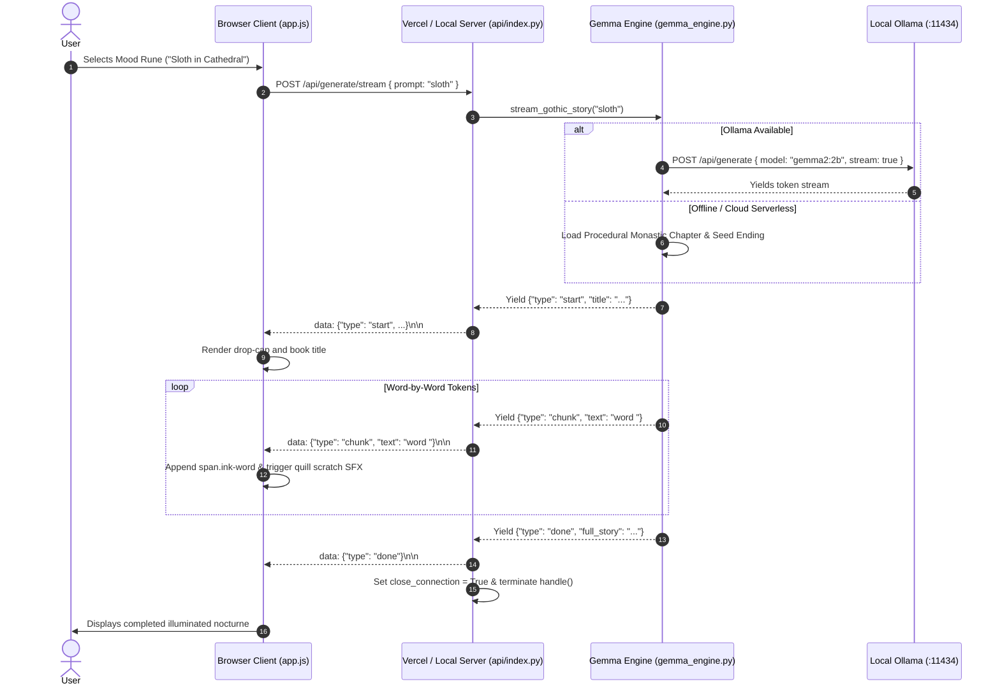

# 🏛️ Compline: Technical Architecture (ARCHITECTURE.md)

**System:** Compline Classical Gothic Bedside Wind-Down Companion  
**Stack:** Vanilla ES6+ JavaScript, Web Audio API, Three.js, Python 3.9 Standard Library, Vercel Serverless, Ollama / Gemma 2  
**Deployment Target:** Dual Runtime (Local Standalone Server / Vercel Serverless Edge)

---

## 1. System Topology & High-Level Architecture

Compline is architected around an **offline-first, zero-bloat** paradigm. The application runs with **zero external pip dependencies** and requires **zero build-step bundlers** (no Webpack, Vite, or Babel), maximizing long-term software preservation and instant startup speed.



---

## 2. Frontend Subsystems Architecture

### 2.1 File Map & Component Structure

```
app/static/
├── css/
│   ├── gothic.css          # Master chiaroscuro styling, phonograph, cards, grimoire
│   ├── tarot.css           # 3D Tarot stage, wheel of fate, card flip animations
│   └── candle-intro.css    # Match strike, candle flame physics, ritual modal
├── js/
│   ├── app.js              # Orchestrator: DOM binding, SSE reader, grimoire, phonograph controller
│   ├── soundscape.js       # Web Audio API engine: phonograph audio, procedural crackle & needle drop SFX
│   ├── candle-sound.js     # Match scratch, wick ignition, candle extinguish audio
│   ├── candle-intro.js     # Candle ignition state machine, blackout mode controller
│   ├── stellar-map.js      # Three.js 3D celestial astrolabe, star catalog, sidereal time calculator
│   ├── tarot-wheel.js      # 60 FPS requestAnimationFrame tarot wheel physics & procedural ratchet SFX
│   └── tarot-cosmos.js     # Tarot deck card definitions and hypnagogic interpretations
└── assets/                 # Ambient audio stems (Opus I-III) and gothic SVG/vector artwork
```

---

### 2.2 Web Audio API Procedural Synthesis Engine (`soundscape.js`)

Rather than relying on static, repetitive `.wav` samples for tactile UI interactions, Compline synthesizes physical acoustics procedurally using the Web Audio API graph:



* **Needle Landing Thump & Click:** Combines a high-frequency triangular contact transient (simulating diamond stylus hitting shellac) with an exponential sub-bass sinusoidal decay (simulating tonearm suspension flex).
* **Dynamic Vinyl Crackle:** Synthesized from a 2-second looped `AudioBuffer` populated with probabilistic impulse peaks passing through a high-Q bandpass filter.

---

### 2.3 Phonograph Kinematics & Groove Seeking Geometry (`app.js`)

The phonograph tonearm operates on a polar coordinate system originating at pivot coordinate $(x_p, y_p) = (27\text{px}, 16\text{px})$ within `#toneArmAssembly`:

$$\text{Angle}(\theta) = \theta_{\text{outer}} + p \cdot (\theta_{\text{inner}} - \theta_{\text{outer}})$$

Where:
- $\theta_{\text{cradle}} = 0.0^\circ$ (Rest Clip, audio off)
- $\theta_{\text{outer}} = 21.0^\circ$ (Outer rim groove, song start $00:00$, $p = 0.0$)
- $\theta_{\text{inner}} = 35.5^\circ$ (Inner run-out groove beside label, song end, $p = 1.0$)
- $\Delta\theta = 14.5^\circ$ (Total playable angular sweep)

#### Direct Vinyl Disc Radial Seeking
When a user clicks or drags across `#vinylRecord`:
1. Spindle center coordinates $(c_x, c_y)$ are calculated from the bounding client rect.
2. The Euclidean distance $r = \sqrt{(x - c_x)^2 + (y - c_y)^2}$ is derived.
3. Song progress $p$ is mapped inversely across the groove boundary:
   $$p = \text{clamp}_{[0, 1]}\left(\frac{R_{\text{outer}} - r}{R_{\text{outer}} - R_{\text{inner}}}\right)$$
   *(where $R_{\text{outer}} \approx 71\text{px}$ and $R_{\text{inner}} \approx 31\text{px}$)*.
4. Audio position is set via `soundscape.seekPhonographRatio(p, true)`.
5. Needle landing transient SFX fires immediately with zero perceived latency.

---

### 2.4 Astronomical Astrolabe & Sidereal Mathematics (`stellar-map.js`)

The celestial sphere is rendered in WebGL via Three.js. Real-time orientation with the physical night sky outside is achieved via **Greenwich Mean Sidereal Time (GMST)** calculations:

$$\text{JD} = \text{Julian Day from UTC Timestamp}$$
$$T = \frac{\text{JD} - 2451545.0}{36525}$$
$$\text{GMST} = 280.46061837 + 360.98564736629 \cdot (\text{JD} - 2451545.0) + 0.000387933 \cdot T^2$$
$$\text{LST} = (\text{GMST} + \lambda_{\text{user}}) \pmod{360^\circ}$$

The virtual celestial sphere rotates by $-\text{LST}$ along the celestial pole axis, aligning the 89 constellation coordinate vectors with the observer's exact zenith.

---

## 3. Backend Architecture & Cloud Serverless Hardening

### 3.1 Dual-Runtime Execution Topology

| Feature | Local Standalone Daemon (`app/server.py`) | Vercel Serverless Function (`api/index.py`) |
| :--- | :--- | :--- |
| **Server Class** | Python `http.server.ThreadingHTTPServer` | Python `BaseHTTPRequestHandler` on AWS Lambda |
| **Concurrency** | Multi-threaded local listener on port 7777 | Ephemeral container spun up per request |
| **Lifecycle Model** | Persistent process daemon | **Single-Request Lifecycle**: explicitly terminates `handle()` |
| **Connection Header** | `Connection: keep-alive` | `Connection: close` (prevents empty socket read hangs) |
| **Pacing Pacing** | Meditative monastic pacing ($0.055\text{s}$ word, $0.26\text{s}$ punct) | Swift serverless pacing ($0.015\text{s}$ word, $0.06\text{s}$ punct) |
| **Execution Ceiling** | Infinite (local laptop) | `maxDuration: 30s` (in `vercel.json`) |

---

### 3.2 Prevention of the 300-Second Serverless Timeout

In standard Python `BaseHTTPRequestHandler`, the default server loop executes:

```python
def handle(self):
    self.close_connection = True
    self.handle_one_request()
    while not self.close_connection:
        self.handle_one_request()
```

If HTTP/1.1 or `Connection: keep-alive` is received from the browser, `self.close_connection` defaults to `False`. On serverless infrastructure, the container only receives **one** HTTP request per invocation. The loop therefore blocked inside `rfile.readline()` waiting for a second request that never arrives, holding the Lambda execution context hostage until Vercel's 300-second kill switch triggered an execution error (causing a 40.1% timeout spike).

**Compline's Architectural Resolution (`api/index.py`):**
1. Overrode `handle()` to strictly enforce single-request execution:
   ```python
   def handle(self):
       self.close_connection = True
       self.handle_one_request()
   ```
2. Appended `Connection: close` to all JSON and SSE stream response headers.
3. Enforced `self.close_connection = True` in `finally:` blocks after streaming exhausts.
4. Set `"maxDuration": 30` in `vercel.json` function specifications.

Result: Function execution duration dropped from **300,000ms (timeout)** to **~4,200ms (clean exit)**.

---

## 4. Sequence Diagrams

### 4.1 Live Story Streaming Protocol (SSE)



---

## 5. API Interface Specification

### `GET /api/status`
Checks system health, Ollama availability, and installed Gemma models.
* **Request:** `GET /api/status`
* **Response (200 OK):**
```json
{
  "app": "Compline: Gothic Wind-Down Companion",
  "theme": "Classical Gothic / Slow and Steady (Hacktoberfest Week 3)",
  "ollama": {
    "available": true,
    "host": "http://localhost:11434",
    "has_gemma": true,
    "gemma_models": ["gemma2:2b"]
  },
  "offline_ready": true,
  "deployed_on": "Vercel Serverless"
}
```

### `POST /api/generate`
Synchronous full-text gothic bedtime story generation.
* **Payload:** `{"prompt": "string", "model": "string|null", "force_offline": false}`
* **Response (200 OK):**
```json
{
  "title": "The Sloth of the Cloister Rafters",
  "story": "High above the stone flagstones of Saint Jerome's Abbey...",
  "model_used": "gemma2:2b",
  "source": "ollama"
}
```

### `POST /api/generate/stream`
Live Server-Sent Events (SSE) token stream.
* **Headers:** `Content-Type: text/event-stream; charset=utf-8`
* **Payload:** `{"prompt": "string", "model": "string|null", "force_offline": false}`
* **Event Protocol:**
  - `{"type": "start", "title": "...", "model": "...", "open_source_note": "..."}`
  - `{"type": "chunk", "text": "..."}`
  - `{"type": "done", "full_story": "..."}`

---

## 6. Security, Privacy & Cache Architecture

1. **Strict Zero-Telemetry Policy:** Zero external tracking pixels, third-party analytics scripts, CDNs, or marketing SDKs are loaded.
2. **CORS:** Open CORS headers (`Access-Control-Allow-Origin: *`) permit decentralized local embedding.
3. **Immutable Asset Caching:** Audio assets (`.mp3`) are served with `Cache-Control: public, max-age=31536000, immutable` and `Accept-Ranges: bytes` to facilitate zero-buffering hardware decoding.
4. **Instant HTML/JS Invalidation:** HTML files are served with `Cache-Control: no-cache, no-store, must-revalidate, max-age=0` ensuring client browsers receive real-time updates without aggressive cache locking.
