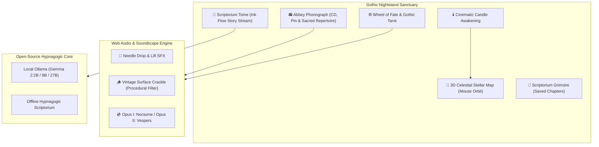

# 🦇 Compline: Classical Gothic Wind-Down Companion

> *"Channel your inner sloth: slow down, conserve your energy, and let the world come to you."*  
> Built for the **Hacktoberfest Open-Source AI Challenge: Week 3 ("Slow and Steady" / International Sloth Day 🦥)**.

[](https://opensource.org/licenses/MIT)
[](https://dev.to/challenges/hacktoberfest-week3-2026-10-19)
[](https://vercel.com/new/clone?repository-url=https%3A%2F%2Fgithub.com%2FXiaoArnav%2Fcomplineapp)
[](https://ai.google.dev/gemma)
[](#)

---

## 🏛️ The Sanctuary Experience

Rooted in medieval monastic architecture and dark romanticism, **Compline** transforms your nightstand into an ancient, candlelit scriptorium designed for effortless, low-cognitive-load sleep induction:

* **🌌 3D Interactive Celestial Stellar Map:** Full-screen 3D starfield with real classical constellations (*Ursa Major*, *Cygnus*, *Orion*, *Cassiopeia*, *Lyra*, *Taurus*), 3D armillary astrolabe rings, gravitational stardust pulses, and live Right Ascension & Declination coordinates. Includes airtight text selection locking so mouse and touch dragging orbits the cosmos without accidental text highlights.
* **📻 The Abbey Phonograph (The CD & The Pin):** A tactile gothic vinyl player with physical tone-arm needle drops, vintage surface crackle, and the **Sacred Repertoire Suite**:
  * **Opus I: Abbey Nocturne** — Solitary nocturnal piano & strings.
  * **Opus II: Gothic Vespers** — Sanctuary bells & ethereal choral chants.
  * **Illuminated Vinyl Sleeves & Steppers:** Real-time spinning mini-discs, live status badges (*On Platter / In Sleeve / Playing*), and quick navigation steppers (`‹` and `›` or `Shift+Left`/`Shift+Right`).
* **🕯️ Nocturnal Owl Shrine & Cinematic Intro:** Cold-to-lit candle awakening ritual—starts in pitch black, strikes a match, catches flame, and floods the sanctuary with warm amber illumination. Tapping the flame blows it out to enter sanctuary blackout.
* **⚙️ Wheel of Fate (Rota Fortunae):** Ornate stained-glass rose window and brass talisman. Spin the wheel to hear procedural clockwork gear ratchets and draw from the 8-card Gothic Slumber Tarot deck.
* **📜 Scribe Ink Streaming:** Word-by-word story generation with illuminated drop-caps, glowing quill cursor, and a wet golden-amber ink drying effect. Powered by open-weight **Gemma 2** (via Ollama) or the built-in offline hypnagogic generator.
* **📖 Scriptorium Grimoire:** Sleepers can inscribe and bookmark nocturnal tales to revisit on future nights with local persistent storage.

---

## 🛠️ Architecture



---

## 🔒 Privacy & Open-Source Principles

* **100% Airplane Mode Safe:** Zero telemetry, zero tracking, and fully functional without an internet connection.
* **Zero SaaS Fees:** High-quality, infinite non-repeating bedtime tales without subscriptions or ad interruptions.
* **Sleep-Inducing Decrescendo:** Stories are strictly prompted to avoid tension, conflict, or cliffhangers, gently lulling the mind into restorative sleep.

---

## 🚀 Quick Start

Compline runs on standard Python 3.9+ with **zero required pip installs**:

```bash
# Clone the repository
git clone https://github.com/XiaoArnav/complineapp.git
cd complineapp

# Launch the Gothic Scriptorium
./run.sh
# or run directly:
python3 app/server.py
```

Then open **`http://localhost:7777`** in your browser.

### 🌐 Deploy to Vercel (1-Click)

[](https://vercel.com/new/clone?repository-url=https%3A%2F%2Fgithub.com%2FXiaoArnav%2Fcomplineapp)

Compline is pre-configured for zero-config Vercel cloud deployment:
1. Click **Deploy with Vercel** above (or import `XiaoArnav/complineapp` in your [Vercel Dashboard](https://vercel.com/new)).
2. Click **Deploy**. Vercel serves the static frontend via edge CDN and runs the API engine on serverless Python (`api/index.py`).

### Optional: Connect Local Gemma 2 via Ollama

If you have [Ollama](https://ollama.ai) installed:

```bash
ollama run gemma2:2b
```

Compline automatically connects to `localhost:11434` and badges the active Gemma model in real time.

---

## 📜 License

Distributed under the [MIT License](LICENSE). Built with devotion for open-source AI and restful sleep.
