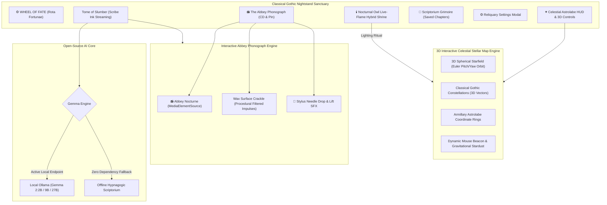

# 🦇 Compline: Classical Gothic Wind-Down Companion

> *"Channel your inner sloth: slow down, conserve your energy, and let the world come to you."*  
> Built for the **Hacktoberfest Open-Source AI Challenge: Week 3 ("Slow and Steady" / International Sloth Day 🦥)**.

[](https://opensource.org/licenses/MIT)
[](https://dev.to/challenges/hacktoberfest-week3-2026-10-19)
[](https://vercel.com/new/clone?repository-url=https%3A%2F%2Fgithub.com%2FXiaoArnav%2Fcompline)
[](https://ai.google.dev/gemma)
[](#)
[](#)

---

## 🏛️ The Classical Gothic Design Philosophy

Rooted in medieval monastic architecture and dark romanticism, **Compline** transports your bedroom or nightstand into an ancient, candlelit scriptorium:

* **Pointed Lancet Arches:** Framing the central *Tome of Slumber* reading altar with carved stone corbel tracery.
* **⚙️ WHEEL OF FATE (Rota Fortunae):** An interactive Gothic Talisman Seal and Stained Glass Rose Window. Spin the wheel to hear procedural clockwork gear ratchets and draw from the 8-card Gothic Slumber Tarot deck (*The Cathedral Sloth*, *The Nocturnal Owl*, *The Beeswax Candle*, etc.).
* **🌌 3D Interactive Celestial Stellar Map:** A live, full-screen 3D celestial sphere operating persistently from the starting page to the landing page. Features real classical constellations (*Ursa Major*, *Cygnus/Northern Cross*, *Orion*, *Cassiopeia*, *Lyra*, *Taurus*), 3D armillary astrolabe coordinate rings, mouse & touch orbit with velocity inertia, dynamic cursor constellation weaving, gravitational stardust shockwaves on click, and live Right Ascension & Declination tracking.
* **📜 Scribe Ink Streaming (Live Typing):** Streams the Gemma story generation word-by-word with an illuminated drop-cap, blinking quill cursor, and a soft vellum ink fade effect (wet golden-amber drying into deep oak-gall blackletter).
* **📻 The Abbey Phonograph (The CD & The Pin):** A minimalist, ultra-tactile gothic gramophone player featuring exclusively the CD and the Pin:
  * **The Sacred Tracklist:** Switch between **Opus I: Abbey Nocturne** (peaceful piano & strings) and **Opus II: Gothic Vespers** (sanctuary chime bells & ethereal choral chant).
  * **The CD (Vinyl Disc):** A rotating grooved master disc with concentric micro-grooves, chiaroscuro sheen, and dynamic center label reflecting the active opus (`OPUS I • NOCTURNE` / `OPUS II • VESPERS`).
  * **The Pin (Tone-Arm & Ruby Needle):** Clicking the Pin, clicking the CD, or tapping the master button puts the pin onto the disc to immediately start spinning and playing with procedural needle-drop audio. Taking the pin off the disc instantly stops playback and returns the pin to rest.
* **📖 The Scriptorium Grimoire:** Sleepers can inscribe and bookmark nocturnal chapters into a personal persistent Grimoire to revisit on future nights.
* **⚙️ Reliquary Settings Modal:** A gothic brass pop-up to configure Phonograph default speeds, surface crackle, or switch between local Gemma 2 models (`gemma2:2b`, `gemma2:9b`, `gemma2:27b`).
* **Cinematic Cold-to-Lit Intro:** Experience the ritual of lighting the sanctuary—starting in pitch black silence with a cold unlit candle, striking the match, watching the solitary flame catch, seeing the golden halo flood the room with warmth, and watching the scriptorium fade into view.
* **⚡ Universal Cross-Device & Butter-Smooth 60/120fps:** Fully responsive layout meticulously tuned for all screens (iPhone, iPad, Android, desktop, and landscape mobile). Features safe-area insets (`env(safe-area-inset-top)`), GPU-accelerated compositing layers (`transform: translateZ(0)`), touch-action delay elimination, zero-waterfall font preconnects, automatic mobile audio unlocking, built-in Gzip compression, and HTTP 304 ETag caching.

---

## 🦥 The "Lazy Payoff"

Modern bedtime is exhausting. When trying to fall asleep, people often search YouTube or podcast apps for sleep stories or rain sounds. The result?
1. **Blue Light & Algorithmic Traps:** Blinding screens and dopamine-driven recommendation feeds trigger doomscrolling.
2. **Ad Startles:** A peaceful meditation suddenly interrupted by a blaring commercial.
3. **Cognitive Load:** Having to search, preview, and select audio tracks when your brain just wants to shut down.

### The Compline Solution:
* **Zero Brainpower:** Tap **one button** (*"Drift Into Slumber"*) or select a single rune (*Brother Silo the Cathedral Sloth*, *Rain on Stained Glass*, *Quiet Stars*, *Castle Hearth*, or *Lavender Cellar*).
* **Automatic Hypnagogic Decrescendo:** Open-weight AI generates a soothing, low-cognitive-load medieval tale with rhythmic cadence and zero suspense.
* **Interactive Abbey Phonograph:** Authentic CD disc & Pin interaction with physical needle-drop landing, vinyl crackle, and soothing classical nocturne playback. Put the Pin on the CD to play, take the Pin off to turn off.

---

## 🔒 Why Open Innovation Matters

Why run an open-weight model on your own device rather than calling a closed commercial cloud API?

1. **Bedroom Privacy:** Nighttime relaxation habits and bedroom routines should never be logged or profiled on corporate cloud servers.
2. **100% Airplane Mode Safe:** Open weights (Gemma 2 via Ollama) and procedural audio run completely offline. You can place your laptop on your nightstand with Wi-Fi disabled—no background notifications, no network pings, no battery drain.
3. **Zero Recurring SaaS Subscriptions:** Sleep apps charge upwards of $70/year for static pre-recorded audio loops. Open-source AI generates infinite, non-repeating bedtime stories for free forever.
4. **Purpose-Prompted Decrescendo:** Open weights allow strict system prompt enforcement for hypnagogic sleep induction (eliminating conflict, tension, and jarring twists).

---

## 🛠️ Architecture



---

## 🏆 Hacktoberfest Prize Category Synergy

* **Featured Category: Best Use of Gemma ($200)**  
  Tuned with a custom *Hypnagogic System Prompt* running locally via Ollama (`gemma2:2b`, `gemma2:9b`, `gemma2:27b`) streaming live word-by-word with low cognitive load and progressive decrescendo.
* **Overall Category: Hacktoberfest Week 3 Winner ($250)**  
  Celebrates International Sloth Day with an original, deeply atmospheric experience that directly rewards laziness and rest.

---

## 🚀 Quick Start (Zero Dependencies)

Compline runs out-of-the-box on standard Python 3.9+ with **zero required pip installs**:

```bash
# Clone the repository
git clone https://github.com/XiaoArnav/compline.git
cd compline

# Launch the Gothic Scriptorium
./run.sh
# or run directly:
python3 app/server.py
```

Now open **`http://localhost:7777`** in your browser.

### 🌐 Deploy to Vercel (1-Click Web Deployment)

Compline is 100% pre-configured for instant zero-config deployment on Vercel:

1. Click the **[Deploy with Vercel](https://vercel.com/new/clone?repository-url=https%3A%2F%2Fgithub.com%2FXiaoArnav%2Fcompline)** button (or import the `XiaoArnav/compline` GitHub repository in your [Vercel Dashboard](https://vercel.com/new)).
2. Click **Deploy**.
3. Vercel automatically deploys the static frontend on its Global Edge Network and executes the story streaming engine on serverless Python (`/api/index.py`) with zero configuration required!

### Optional: Connect Local Gemma 2 via Ollama
If you have [Ollama](https://ollama.ai) installed:
```bash
ollama run gemma2:2b
```
Compline automatically detects the active Gemma instance on `localhost:11434` and badges it in real time!

---

## 📜 License

Distributed under the [MIT License](LICENSE). Built with love for open-source AI and lazy nights.
